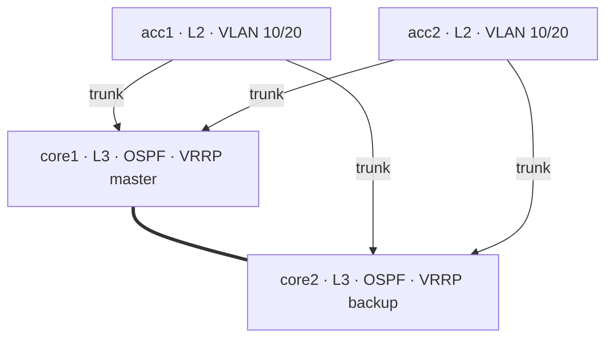

# NetDevOps Lab

Treat a network like software. This project builds a small campus network in containers, defines its entire configuration as code, deploys it with Python automation, validates it with automated tests, and even lets you ask it questions in plain English with a local LLM.

I built it while studying for my CCNA, to go past "I can configure a switch" and show the thing network teams are actually moving toward: **version-controlled, tested, automated networks** — no physical gear required.

## The network

A classic two-tier campus: redundant Layer 3 cores running OSPF and acting as VLAN gateways (with VRRP for failover), and Layer 2 access switches dual-homed to both cores.



- **VLAN 10 (USERS)** — 10.0.10.0/24, gateway 10.0.10.1 (VRRP)
- **VLAN 20 (SERVERS)** — 10.0.20.0/24, gateway 10.0.20.1 (VRRP)
- **OSPF area 0** between the cores; SVIs provide inter-VLAN routing

## How it works

```
inventory/hosts.yaml   ──►  render_configs.py  ──►  rendered/*.cfg  ──►  deploy.py  ──►  live lab
   (source of truth)        (Jinja2 template)       (real EOS config)    (NAPALM merge)

                                        pytest  ◄── validates the running network
                                 ai/ask_network.py  ◄── query it in plain English
```

You never edit a device directly. You edit the **inventory** (the source of truth), the pipeline renders it into real config, pushes it, and the tests confirm the network behaves. If someone fat-fingers a change on a device, `backup.py` + a diff against `rendered/` catches the drift.

## What it demonstrates (and where it maps to CCNA)

| Skill | In this repo | CCNA topic |
|---|---|---|
| VLANs & trunking | `inventory/hosts.yaml`, `templates/eos/full_config.j2` | Layer 2 switching |
| Inter-VLAN routing (SVIs) | core `svis` + `ip routing` | Routing concepts |
| OSPF | `ospf` blocks + validation test | Dynamic routing |
| First-hop redundancy (VRRP) | core SVIs with `vrrp` | FHRP |
| IP addressing / subnetting | the data model | IPv4 addressing |
| Automation & IaC | Nornir + Jinja2 + NAPALM | (beyond CCNA — your edge) |
| Testing & CI/CD | `tests/`, `.github/workflows/` | (beyond CCNA — your edge) |

## Setup

**Prerequisites:** Docker, Python 3.10+, and a Linux host (WSL2 works great).

**1. Install Containerlab**
```bash
bash -c "$(curl -sL https://get.containerlab.dev)"
```

**2. Get the Arista cEOS image** (one-time, free)
Make a free account at arista.com, download **cEOS-lab** (e.g. `cEOS-lab-4.32.0F.tar.xz`), then import it — the tag must match `clab/campus.clab.yml`:
```bash
docker import cEOS-lab-4.32.0F.tar.xz ceos:4.32.0F
```

**3. Deploy the lab**
```bash
sudo containerlab deploy -t clab/campus.clab.yml
sudo containerlab inspect -t clab/campus.clab.yml   # see the devices + mgmt IPs
```

**4. Install the Python tooling**
```bash
pip install -r requirements.txt
```

**5. Render and deploy the config**
```bash
python render_configs.py        # inventory -> rendered/*.cfg
python deploy.py --check        # dry run: see the diff
python deploy.py                # apply it
```

**6. Validate the network**
```bash
pytest -v
```

**7. Ask the network (local AI)**
```bash
ollama pull gemma3:4b
python ai/ask_network.py "is OSPF up between the cores?"
python ai/ask_network.py "what VLANs are configured on acc1?"
```

**Tear down** when done:
```bash
sudo containerlab destroy -t clab/campus.clab.yml
```

## Repo structure

```
netdevops-lab/
├── clab/
│   ├── campus.clab.yml      # the topology
│   └── configs/             # per-device bootstrap (mgmt + login)
├── inventory/               # source of truth (hosts, groups, creds)
├── templates/eos/           # Jinja2 -> EOS config
├── render_configs.py        # inventory -> rendered configs
├── deploy.py                # push configs (NAPALM merge, --check for dry run)
├── backup.py                # pull running configs (drift detection)
├── tests/test_network.py    # automated validation (OSPF, VLANs, routing)
├── ai/ask_network.py        # local-LLM "ask the network" assistant
└── .github/workflows/       # network CI (renders + lints on every push)
```

## Roadmap

- Spine-leaf fabric with BGP (EVPN/VXLAN) as a second topology
- `pyATS`/`genie` for richer structured validation
- Automatic drift remediation (detect + re-apply source of truth)
- Linux host nodes to test real end-to-end user connectivity
- Telemetry (gNMI) into Grafana
- AI: natural-language *config changes* with a human-approval gate

## Notes

- VRRP syntax here targets EOS 4.21+ (`vrrp <id> ipv4 ...`, `priority-level`). Older EOS uses `vrrp <id> ip ...` / `priority`.
- Credentials in `inventory/defaults.yaml` are lab-only. In production these come from environment variables or a secrets vault — never commit real ones.
